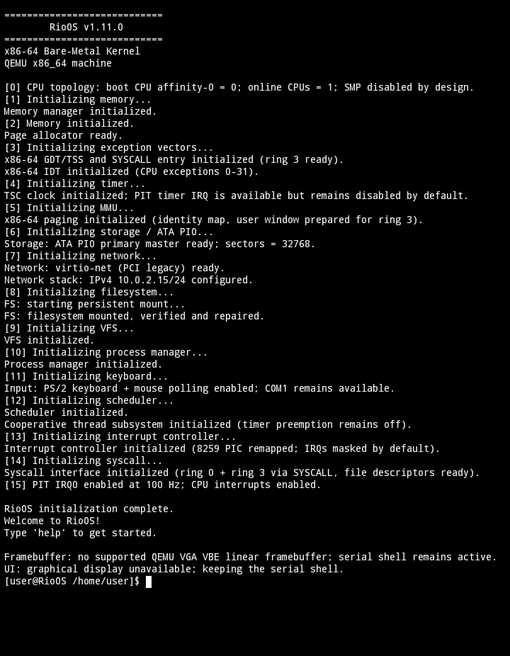

# RioOS-x86-64 

This repository is the x86-64 port of MyKernel/RioOS: a freestanding C++17 + assembly kernel for the QEMU PC machine. The guest runs without Linux; normal boot does not require GRUB or an ISO.

> **Verification status:** the project includes host unit tests and x86-64 ELF/Multiboot structural checks. The source package has not been runtime-tested with `qemu-system-x86_64` in the environment used to prepare this ZIP, so a real QEMU boot should still be tested on the target device.

## RioOS Preview



*RioOS x86-64 running on the QEMU PC machine.*

## Build and run

Required build tools: `clang`, `clang++`, `ld.lld`, and Python 3. To run, install `qemu-system-x86_64` with a display backend if you need the graphical modes.

### Linux

```sh
bash linux/build.sh --clean
bash linux/run.sh                 # headless serial shell in this terminal
bash linux/run-terminal.sh        # original shell in a separate black QEMU window
bash linux/run-ui.sh              # graphical pixel UI, keyboard + PS/2 mouse
bash linux/make-x86_64-iso.sh     # optional ISO; requires grub-mkrescue + xorriso
```

### Termux on Android

```sh
bash termux/build.sh --clean
bash termux/run.sh
bash termux/run-terminal.sh       # requires a graphical QEMU backend / Termux:X11
bash termux/run-ui.sh
```

Tool availability depends on the packages and QEMU build available in the configured Termux repositories. Building and structural checks can work even if a suitable QEMU graphical frontend is unavailable.

### macOS

```sh
bash macos/build.sh --clean
bash macos/run.sh
bash macos/run-terminal.sh
bash macos/run-ui.sh
```

The wrappers default to QEMU's Cocoa display backend for windowed modes; set `RIOOS_DISPLAY` to a backend supported by your QEMU build if needed.

### Windows PowerShell

```powershell
.\windowsuild.ps1 --clean
.\windows
un.ps1
.\windows
un-terminal.ps1
.\windows
un-ui.ps1
```

Use a PowerShell environment where Clang, `ld.lld`, Python, and QEMU are on `PATH`. `build-x86_64.sh` remains available in each Bash platform folder as a compatibility alias for `build.sh`; Windows has `build-x86_64.ps1` as an alias.

### Build options

The Bash build supports `--clean`, `--verbose` / `-v`, `--skip-tests`, `--run`, and `--help`. PowerShell supports `--clean`, `--skip-tests`, `--run`, and `--help`. Build products are written to `build-x86_64/`; user ELFs are in `build-x86_64/user/`, and `storage/disk.img` is the persistent 16 MiB MyFS disk. Back up the disk image before deleting or regenerating it if you need to keep guest files.

## Included features

- Shell, command history, environment variables, pipes/redirection, MyFS + VFS, file permissions, users (`user`, `su root` / password `123`), file descriptors and pipes.
- Ring-3 user programs: `exec <elf>`, `nano <file>` (Ctrl+S/Ctrl+O save, Ctrl+X exit), `calc [expr]`, and `userdemo`; per-program page tables, NX/W^X, pointer validation, and process-local fault termination.
- Pixel UI: lock screen, home screen, Terminal, Calculator, Clock, Files, Launcher, Wallpaper, and Settings.
- PS/2 keyboard/mouse input with on-screen cursor, QEMU standard VGA / Bochs VBE framebuffer, and a serial shell fallback.
- PCI legacy VirtIO networking with ARP/IPv4/ICMP/UDP/DNS support (`ifconfig`, `ping`, `nslookup`, and UDP socket syscalls), ATA PIO disk, CMOS RTC, PIT/TSC timer, PIC interrupt handlers, and cooperative kernel threads.

See [the x86-64 port notes](docs/X86_64_PORT.md), [build guide](docs/BUILD_AND_RUN.md), and [development notes](docs/DEVELOPMENT.md) for implementation details and known limits.

## License

See [docs/LICENSE](docs/LICENSE).
